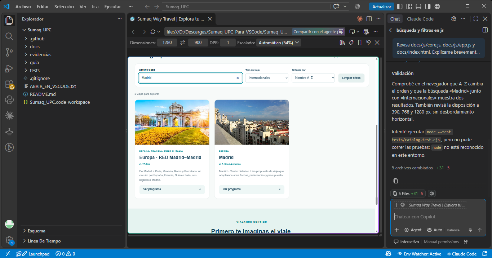

# Evidencia real de GitHub Copilot

Estudiante: Hugo Serrano. Curso: Inteligencia Artificial. Docente: Lennin Percy Cenas Vasquez. Trabajo individual.

## Solicitud utilizada en VS Code

> Revisa docs/js/core.js, docs/js/app.js y docs/index.html. Explícame brevemente cómo funcionan la búsqueda y los filtros.
>
> Después agrega un selector “Ordenar por” con dos opciones: “Orden original” y “Nombre A–Z”.
>
> Debe funcionar junto con la búsqueda y los filtros, sin modificar el catálogo original. Conserva el diseño responsive y no agregues dependencias.
>
> Implementa la mejora, agrega las pruebas correspondientes y explícame qué cambiaste. Si no puedes ejecutar las pruebas, indícalo.

## Resultado y decisiones

Copilot entregó cambios en cinco archivos y tres pruebas nuevas. Se conservaron la función pura que copia antes de ordenar, el selector con etiqueta accesible y el ordenamiento posterior a los filtros. Se mantuvo la estructura estática sin nuevas dependencias. La base anterior fue preparada con ChatGPT/Codex; no se atribuye a Copilot.

La captura muestra “Madrid”, categoría “Internacionales”, orden “Nombre A–Z” y dos resultados. Copilot reporta comprobaciones de interfaz a 390, 768 y 1280 px, y aclara que Node no estaba disponible para ejecutar pruebas. La revisión posterior con Codex ejecutó las 15 pruebas y todas pasaron.

Archivos: docs/index.html, docs/css/styles.css, docs/js/core.js, docs/js/app.js y tests/catalog.test.cjs.
